# 小粒宝 GranPal · 慢性粒细胞白血病（CML）患者工作台

**一句话定位**：把 CML 的「一条 BCR::ABL1 国际标尺分子线 × 每天一粒 TKI」整理成患者自己讲得清、复诊时带得走的本机资料。

**不做声明**：本工作台只做**信息整理与就诊准备**——不做诊断、不做治疗建议、不判读报告、不回答"能不能停药"。所有结论都留在诊室；这里只把报告原文、医嘱原话、日期与来源摆在一起。数值一律照抄报告，不换算、不判读。

> ⚠️ 数据来源与状态：原型/开发版页面展示的是**虚构演示数据**（`demo/build-demo-data.mjs` 唯一源）。一手患者访谈数 **= 0**（如实声明，见 [USER-RESEARCH](docs/USER-RESEARCH.md)）；医学口径来自《中国 CML 诊断与治疗指南（2025）》等 A 级来源，未核实项已在文档中标「未核实」。

## 关键功能

### 看板：我现在该做什么
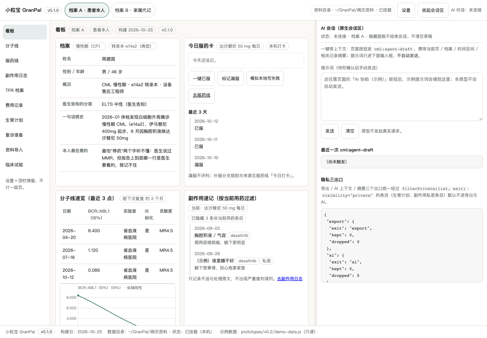
一眼看到"今天吃药了吗 / 最近一次分子结果 / 有没有不舒服 / 下次复查还有多久"。患者原话（改写）：*"最怕'停药'两个字听不懂：医生说过 MMR，但报告上到底哪一行是医生要看的，我记不住。"*

### 分子线：为什么这张图要分段画（本癌种最差异化的一页）
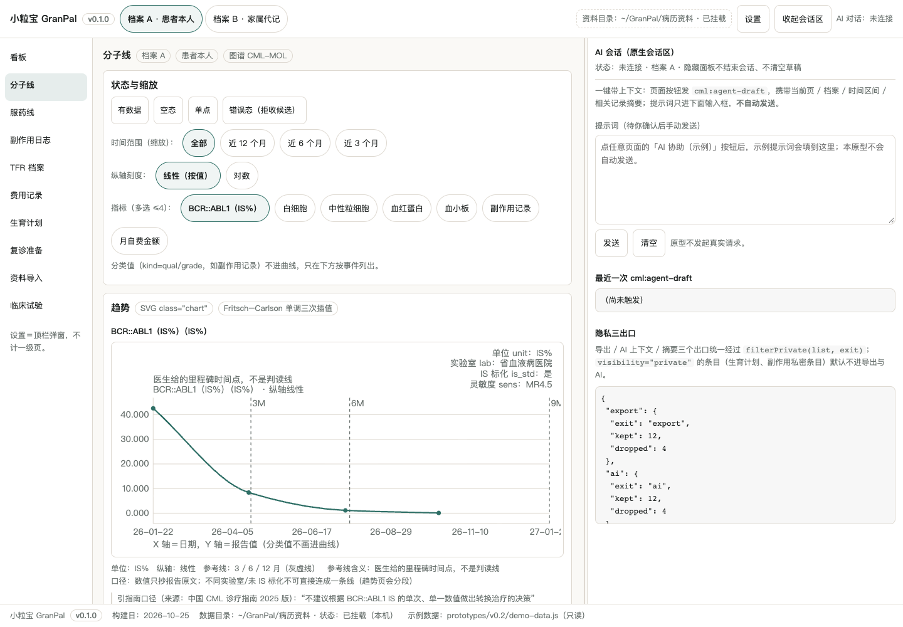
每次 qPCR 都记下**可比性四要素**：单位（IS%）、实验室、是否 IS 标化、检测灵敏度。四个要素不一致的点**不连线**，在断点标「不可比」。图上 3/6/12 月参考线旁边写着"医生给的里程碑时间点，**不是判读线**"——依据是指南原文："不建议根据 BCR::ABL1 IS 的单次、单一数值做出转换治疗的决策"。

### 治疗路径折叠卡：默认只看概要，点开看五块细节

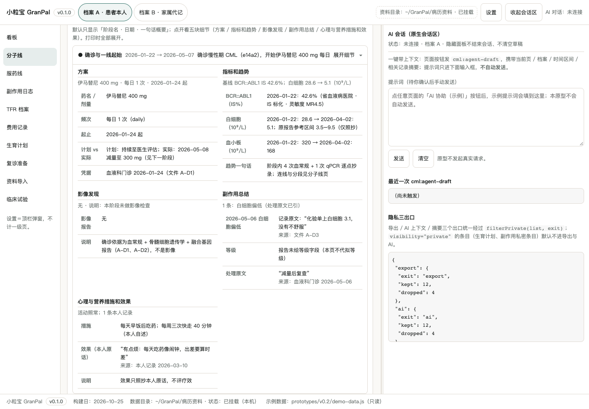
每阶段一张卡，默认全部收起；展开固定五块：方案 / 指标和趋势 / 影像发现 / 副作用总结 / 心理与营养措施和效果。**没有的内容写"无 + 说明"，不省略块**；影像与副作用只抄原文原文，不代拟等级；「效果」一栏只放本人原话。

### 指标卡：按类别分系列，点一下翻面看历次（本癌种新增）
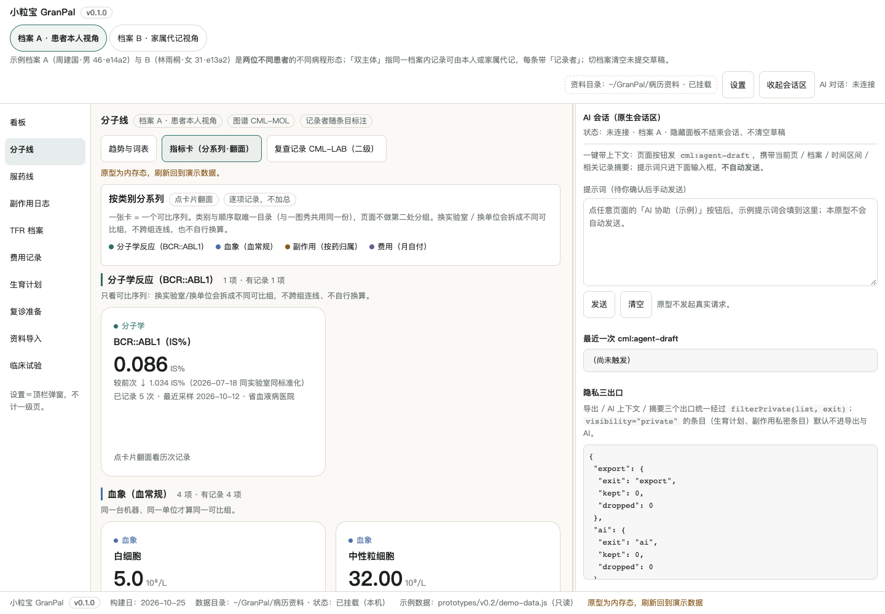
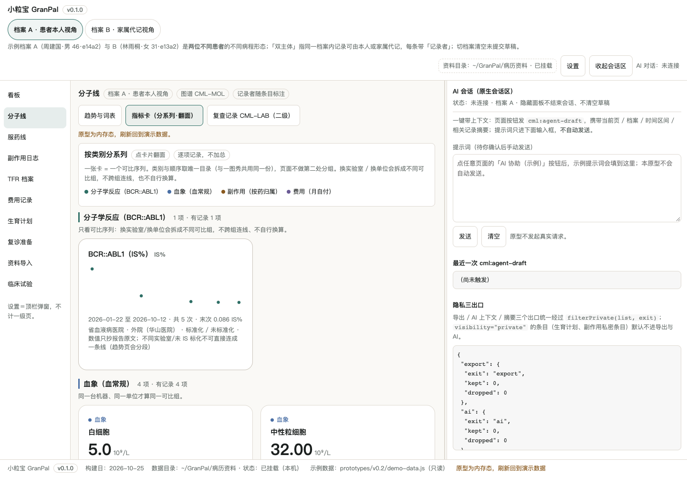
一张卡 = 一个**可比序列**（同实验室 + 同 IS 标化状态 + 同单位），按分子学 / 血象 / 副作用 / 费用四类分组；类别顺序与颜色取唯一目录，和下面一图秀共用。
点整卡翻 180° 看历次数据点，**翻转前后卡片大小位置完全不变**（实测位移 0.0），再点回正面；每张卡独立翻，各卡互不影响。
正面固定六段：类别眉题 / 指标名 / 最近值+原单位 / 与**同组前次**的比较 / 记录次数+最近采样日 / 来源。
没有记录写「还没有记录」而不是 0（0 也是有效记录）；只有一个点写「暂无可比较的前次记录」。**本页不做任何加总**，不给整体评级。

### 病情一图秀：几条线一起看变化趋势
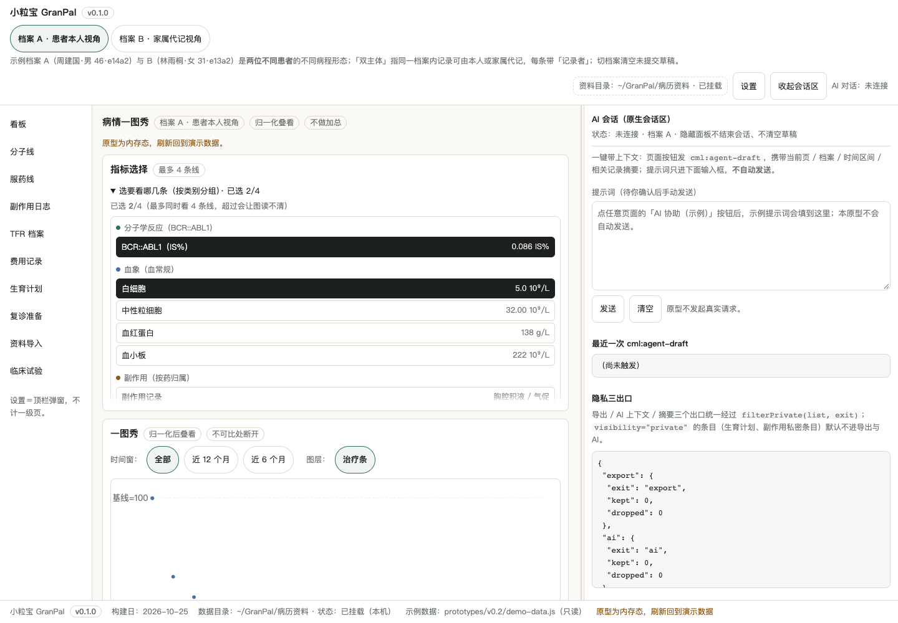
指标选择窗口按类别分组、可独立滚动、最多同时选 4 条。每条线以自己的首个记录为基线做归一化，所以**纵向高度只表示变化幅度，不表示数值大小**——要看绝对值去指标卡。
换实验室 / 未 IS 标化的记录处曲线**断开**，图上直接写「不可比提示」，不跨组连线也不自行换算。治疗条与数据区分层：关掉治疗条，曲线一点不变。

### 临床试验：先建档，再看"和我什么关系"
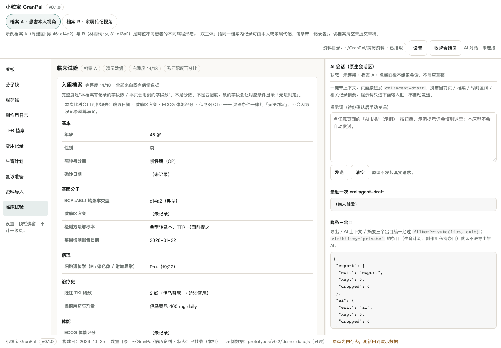
入组档案 **18 个字段 / 7 组**全部来自已经记过的病情数据，不重复录入；卡头显示**完整度 x/y** 并列出"这次分析会用到但你没记的字段"。
每条入排条件只给三种结论：**已满足 / 可能冲突 / 无法判定**，逐条附「你的记录」与来源原文。**缺字段一律判「无法判定」，绝不会因为缺数据就变成"已满足"**；规则本身还没来得及人工确认的，单列「待确认规则」，不参与判定。
汇总行只数个数，**不给匹配度百分比、不给推荐、不按匹配度排序**（排序永远按数据来源顺序）。渠道覆盖如实显示：这次只查到几个渠道、哪些没在查（"没查到"不等于"没有试验"）。
本版 4 条试验是**演示虚构**记录，页面逐条标注；M4 接 unified-trial-mcp 后整体替换。

### 副作用日志：按当前用药过滤，不是全表平铺
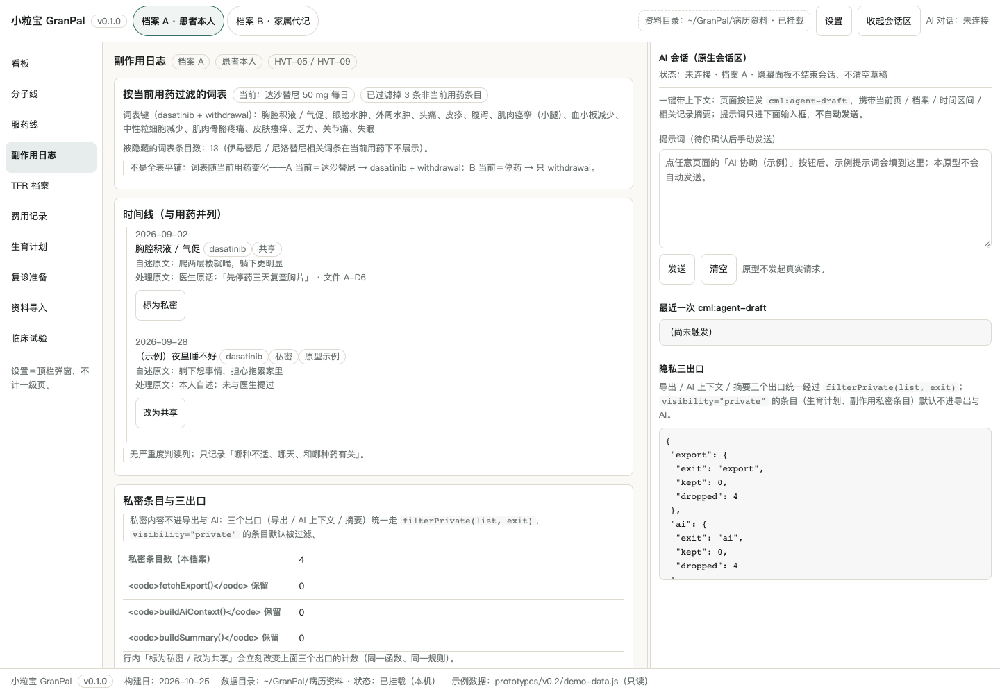
换过药的人最怕"这个不舒服到底是哪种药带来的"。词表跟着**当前用药**走（达沙替尼→胸腔积液/肺动脉高压；伊马替尼→水肿/肌痉挛；停药期→肌骨痛/瘙痒），并显示"已隐藏 N 条非当前用药条目"。

### TFR 档案：把"诊室要看的几行"准备好（零建议）
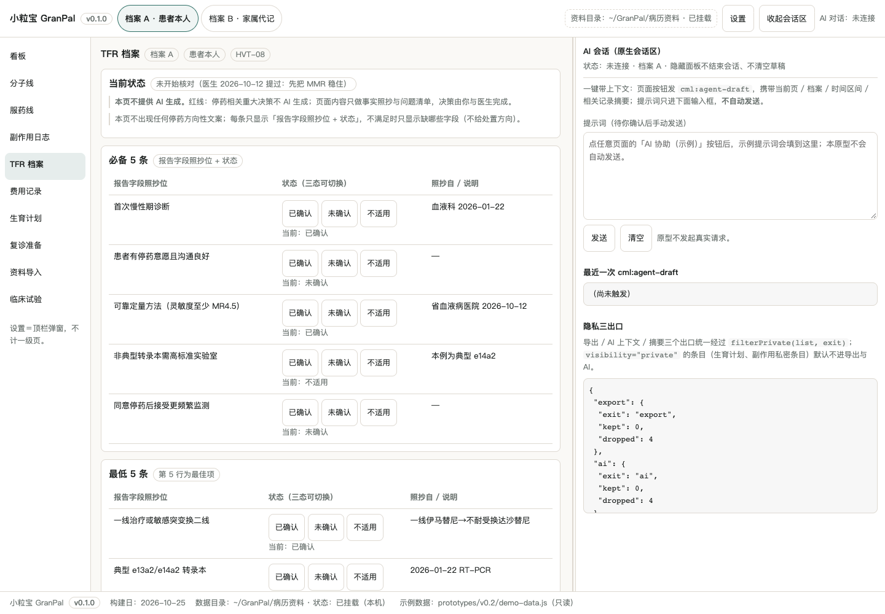
停药尝试的书面条件（必备 5 / 最低 5 / 最佳项）逐条列出**报告字段照抄位**与密测节奏（停药后前 6 个月每 1–2 个月、第 7–12 个月每 2 个月、之后每 3 个月）。本页**没有任何"可以停药/建议停药"**，也**不提供 AI 生成**。

### 窄宽与大字
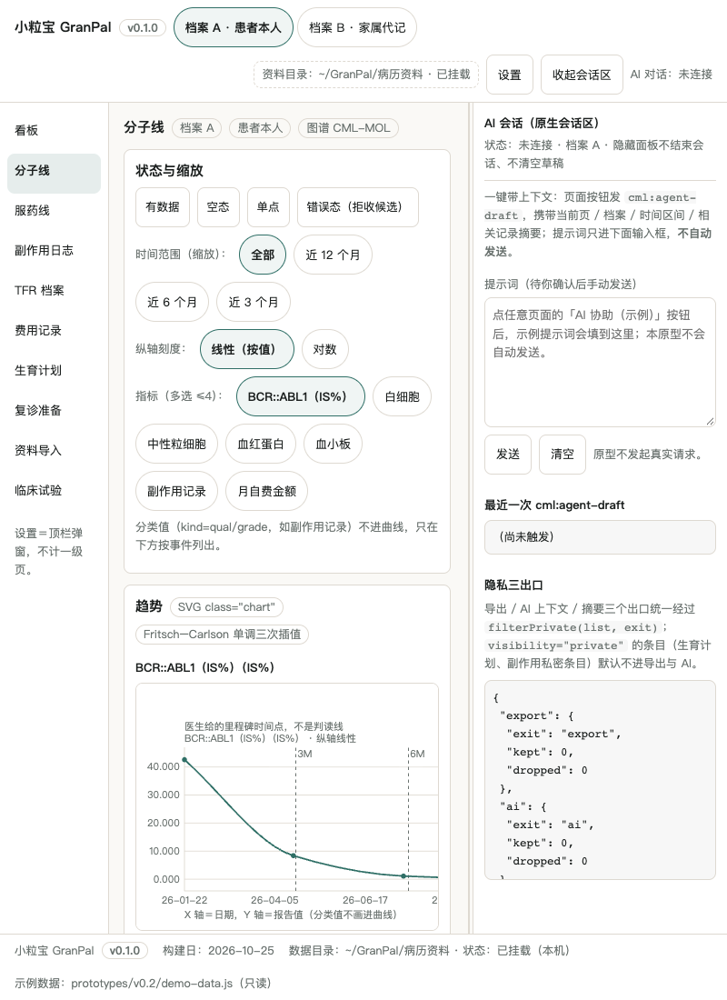
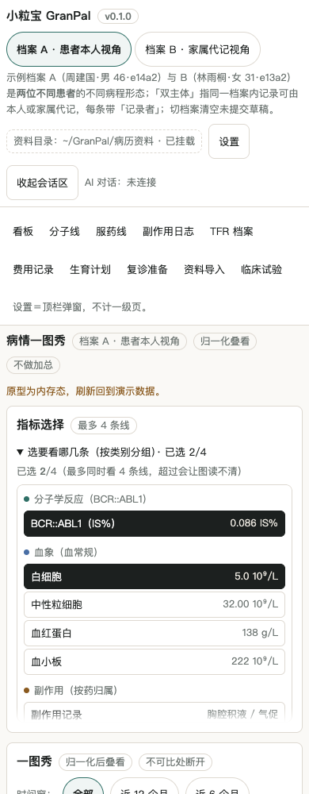
≤900px 单列、≤720px 卡片全宽且图表可横向滚动；指标卡网格在 **1440/1080/860 三档列数 2/2/1**、卡高恒定 276px。
四档宽度（1440/1024/800/420）× **11 页**横向溢出 = 0；390px 下 `body.scrollWidth === innerWidth === 390`，横滚只发生在图表容器内。

## 怎么用

1. 本机打开原型（无需构建）：`node demo/build-demo-data.mjs && python3 -m http.server 8080 -d prototypes/v0.2`，浏览器开 `http://127.0.0.1:8080/#dash`。
2. DSH Desktop 安装版（M5/M6 后）：`pnpm add <tgz>` 到目标 profile，**重启 Desktop 后先新建一个会话**（宿主按会话授权资料目录），再进入工作台。
3. 顶栏可切换「档案 A（患者本人）/ 档案 B（家属代记）」；右侧原生 AI 会话区可拖宽 25%–45%、可收起（收起不结束会话、不清空草稿）。

## 数据与口径

- **本机优先**：资料目录由宿主按会话授权；导出 / AI 上下文 / 摘要三个出口统一经 `filterPrivate(list, exit)` 代码级过滤，`visibility="private"` 的条目默认不进导出与 AI。
- **只有一个数据源**：演示数据由 `demo/build-demo-data.mjs` 生成（`demo/demo-data.js` 与 SQLite 同源）；原型不写回、不另造数据。
- **双主体**：`author_role`（本人 / 家属代记）+ 可见性；代记条目带来源标记。
- **临床试验数据**：M4 阶段抓取，登记状态以平台页为准（未核实的写「未核实」）。
- 版本：**v0.1.0**（构建日 2026-10-25）。

## 开发

```bash
npm run check            # 语法 + 包合同 + 宿主注册契约（第一天必绿）
node scripts/check-prototype.mjs    # 原型静态纪律（页面/折叠卡/图表/红线/字号/面板）
node scripts/check-demo-data.mjs    # 数据层六条硬纪律（唯一源/显式 null/分类不进趋势/无判读列）
python3 scripts/probe-page-view.py  # 实渲走查：4 档宽度 + 折叠收/展 + 截图（需本机 Chrome）
node demo/build-demo-data.mjs       # 重新生成演示数据（唯一源）
```

文档索引：规格 [SPEC](docs/SPEC.md) · 场景 [SCENARIOS](docs/SCENARIOS.md) · 交互路径 [INTERACTION-DESIGN](docs/INTERACTION-DESIGN.md) · HVT 审核 [HVT-REVIEW](docs/HVT-REVIEW.md) · 差异矩阵 [DIFF-MATRIX](docs/DIFF-MATRIX.md) · 强约束 [DEV-REQUIREMENTS](docs/DEV-REQUIREMENTS-2026-10-25.md) · 进度判据 [DEV-PLAN](docs/DEV-PLAN.md) · 医学调研 [medical](research/medical-cml-10-topics.md) · 用户研究 [user](research/user-cml-narratives.md) · 家族对比 [family](research/family-comparison-cml.md)
